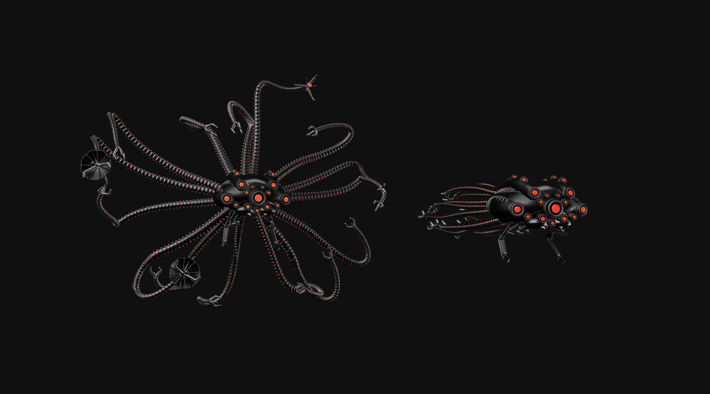

# Matrix Squid

A procedural Three.js swarm inspired by the Sentinels from *The Matrix*: articulated mechanical tentacles, red optics, dark metal and autonomous movement through a foggy 3D space.

**[Open the live demo](https://matrix-squid.danieljohnmorris.com)**



## The scene

Each Sentinel has a sculpted mechanical head, fifteen segmented tentacles, articulated jaw limbs and deployable sensor hardware. Three animation modes blend together:

- **Coast:** tentacles trail along the swimmer's previous path and lag through turns.
- **Propel:** tentacles spread and contract progressively from root to tip, producing a short burst of speed while retaining inertia.
- **Sense:** the swimmer slows to a stop, looks around and deploys sensor probes and dishes; the tentacles settle rather than rotating rigidly with the head.

Swimmers independently choose changing 3D destinations rather than following closed patrol loops. Collision-avoidance steering and an eight-unit minimum turn radius preserve broad turns and trailing tentacle inertia. Near and distant roaming volumes provide depth; approaching their limits bends a swimmer back inward without snapping or teleporting. Squid can leave the frame and return—the screen edges are not walls, and orbiting the camera does not move their world-space limits.

Foreground swimmers also make staggered, randomized approach-and-retreat passes through the initial camera view. One starts facing forward; later passes blend back into independent roaming. Approach destinations account for perspective and portrait aspect ratios, while avoidance can still divert a pass and squid can naturally leave the frame. Orbiting does not make the swarm chase the camera.

Population scales with viewport width, including fullscreen and live resizing:

| Viewport width (CSS pixels) | Squid |
| --- | --- |
| Below 640 | 4 |
| 640–1199 | 6 |
| 1200–1919 | 8 |
| 1920–2999 | 12 |
| 3000 and above | 16 |

Roaming width also follows the viewport aspect ratio, spreading the swarm across ultrawide displays while keeping portrait roaming narrower. Existing swimmers retain their positions when resizing; they steer gradually into the updated volumes. Removed swimmers release their procedural geometry and materials; new swimmers share the existing baked metal maps.

Distance fog attenuates light toward black, keeping far swimmers dark rather than tinting them grey. A slowly drifting procedural backdrop adds subtle charcoal haze without particles or a screen-space overlay; it does not illuminate the squid. Directional lights and neutral environment reflections reveal the metal; subdued red running lights follow the simulated tentacle segments.

Tentacle vertebrae, collars, joint caps and claws use darker gunmetal than the head hardware, retaining lighting-driven highlights without continuous silver bands.

Main tentacles range from 10.125 to 13.2 model units, approximately four to five head-shell lengths. Each uses 84 segments, preserving vertebra and running-light spacing while extending the world-space trail and avoidance sampling.

The six small underside manipulators are separate hinged tools: flattened links, exposed parallel actuators and hooked pincers. They normally fold beneath the chin, occasionally reaching or hanging in staggered pairs rather than paddling with the propulsion stroke.

## Controls

| Control | Action |
| --- | --- |
| Drag | Orbit the camera |
| Scroll or pinch | Zoom |
| Pause / play icon | Pause or resume the animation |
| Fullscreen icon | Enter or exit fullscreen, where supported |
| GitHub icon | Open this repository |

The scene respects reduced-motion preferences and suspends animation while the tab is hidden. Icon controls retain accessible labels and tooltips.

## Omarchy screensaver plugin

The repository root is also an [Omarchy](https://omarchy.org/) shell plugin that replaces the idle screensaver with this swarm, one fullscreen window per monitor.

```sh
omarchy plugin add https://github.com/danieljohnmorris/matrix-squid.git --enable
```

It follows the existing `idle.screensaver` timing in `~/.config/omarchy/shell.json` and Omarchy's skip rules: stay awake, `omarchy toggle screensaver` and a locked session. Any key, click, scroll or pointer movement exits; so does locking. Lock timing is unchanged.

Start it immediately with:

```sh
omarchy-shell matrix-squid launch
```

Omarchy has no screensaver hook, so the plugin starts one second before the built-in screensaver and uses its `org.omarchy.screensaver` window class: Omarchy's fullscreen window rules apply, and its terminal screensaver sees one already running and stays closed. *System > Screensaver* still opens the terminal screensaver.

Dependencies, all in Omarchy's base install: `python-gobject` and WebKitGTK (`webkit2gtk-4.1`, pulled in by `aether`) with WebGL hardware acceleration. The plugin needs no network access, build step or privileges; it renders the committed `screensaver/` bundle. After changing the scene, rebuild it with `npm run build:screensaver` and commit the result.

Remove it with:

```sh
omarchy plugin remove io.github.danieljohnmorris.matrix-squid
```

## Run locally

Use Node.js 22 and npm, plus a browser with WebGL and hardware acceleration enabled.

```sh
git clone https://github.com/danieljohnmorris/matrix-squid.git
cd matrix-squid
npm ci
npm run dev -- --port 4330
```

Open [http://127.0.0.1:4330](http://127.0.0.1:4330).

```sh
npm test          # Motion and model regression tests
npm run build     # Production files in dist/
npm run preview   # Serve the production build locally
```

## Metal materials and vgpu

[vgpu](https://github.com/vercel-labs/vgpu) runs the WGSL shader in `scripts/metal.wgsl` offline to bake 512 × 512 roughness and normal maps. Three.js applies those maps to the metallic surfaces alongside a generated reflection environment and ACES tone mapping.

**The browser renderer remains Three.js/WebGL. WebGPU is only needed to regenerate the textures**, not to view, build or deploy the site.

On a development machine with a supported WebGPU adapter:

```sh
npm run bake:metal
```

This replaces `public/textures/metal-roughness.png` and `public/textures/metal-normal.png`. Commit the generated PNGs alongside shader changes; normal builds use these checked-in assets.

## Source layout

| File | Responsibility |
| --- | --- |
| `main.js` | Scene, lighting, camera, routes, animation phases and controls |
| `sentinel-model.js` | Procedural geometry, articulated limbs and tentacle simulation |
| `swim-motion.js` | Steering, collision avoidance and position history |
| `sensor-hardware.js` | Deployable probes and dishes |
| `metal-finish.js` | Material maps and reflection environment |
| `scripts/metal.wgsl` | Procedural metal texture shader |
| `scripts/bake-metal.mjs` | Headless vgpu texture generation |
| `index.html` | Full-window canvas host and accessible icon controls |
| `manifest.json`, `Service.qml` | Omarchy shell plugin: idle trigger and `matrix-squid` IPC target |
| `bin/matrix-squid-screensaver` | Fullscreen WebKitGTK host for the Omarchy screensaver |
| `screensaver/` | Committed `npm run build:screensaver` bundle loaded by that host |

## Deploy

Serve `dist/` from a static web host after `npm run build`, or use the included Node-to-nginx Docker build:

```sh
docker build -t matrix-squid .
docker run --rm -p 8080:80 matrix-squid
```

The container serves the site at `http://localhost:8080`. It does not regenerate textures or require a GPU.

See [CHANGELOG.md](CHANGELOG.md) for changes.

## Attribution

An unofficial fan-made procedural graphics experiment, not affiliated with *The Matrix* rights holders. Built with [Three.js](https://threejs.org/), [Vite](https://vite.dev/) and [vgpu](https://vgpu.sh/).
